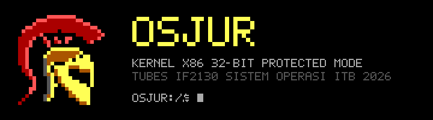
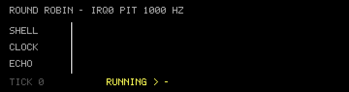
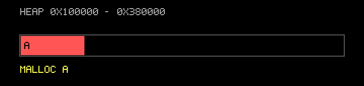
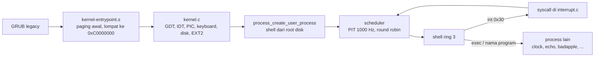
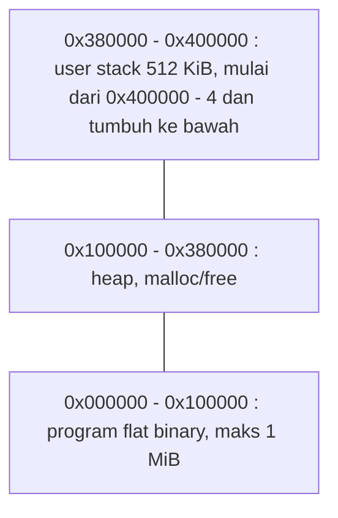

<p align="center">

</p>

# OSjur

<p align="center">
<a href="https://github.com/mobyy17/OSjur/releases"></a>
<a href="https://github.com/mobyy17/OSjur/releases"></a>
<a href="https://github.com/mobyy17/OSjur/commits/main"></a>


</p>

<p align="center"></p>
<p align="center">Maskot Kelompok OSjur</p>

Kernel x86 32-bit protected mode buatan kelompok OSjur untuk Tugas Besar IF2130 Sistem Operasi ITB 2026. Kernel jalan di higher half `0xC0000000`, membaca dan menulis disk 4 MiB berformat EXT2 IF2130 Edition lewat ATA PIO, dan menjalankan sampai 16 process dengan scheduler round robin di atas timer PIT 1000 Hz. Shell-nya program biasa di ring 3 yang bicara ke kernel lewat 26 syscall `int 0x30` (nomor 0 sampai 26, nomor 19 kosong).

| | |
|---|---|
| Arsitektur | i386, protected mode, paging 4 KiB, higher half |
| Bahasa | C freestanding (GCC), assembly NASM |
| Boot | GRUB legacy dari ISO |
| Emulator | QEMU `qemu-system-i386`, machine default `pc` |

## Quick start

Di Ubuntu (24.04 atau 22.04 di WSL2):

```
sudo apt install -y nasm gcc make qemu-system-x86 qemu-utils genisoimage
make disk
make insert-shell
make insert-apps
make insert-bonus
make start
```

Jendela QEMU terbuka, banner helm Sparta tergambar, lalu muncul prompt `OSjur:/$`. Coba `help`, `ls`, atau `memtest`. Kalau layarnya hitam dan diam, kamu menjalankan `make run`, bukan `make start` (lihat [Troubleshooting](#troubleshooting)).

## Daftar isi

- [Demo](#demo)
- [Cakupan spesifikasi](#cakupan-spesifikasi)
- [Fitur wajib](#fitur-wajib)
- [Bonus](#bonus)
- [Build dan menjalankan](#build-dan-menjalankan)
- [Command shell](#command-shell)
- [Syscall](#syscall)
- [Arsitektur](#arsitektur)
- [Batasan dan keputusan desain](#batasan-dan-keputusan-desain)
- [Troubleshooting](#troubleshooting)
- [Kontributor](#kontributor)

## Demo

<p align="center">

</p>

Rekaman asli dari QEMU: banner boot, lalu `help`, `memtest`, `args`, `sh demo.sh`, `bg`.

## Cakupan spesifikasi

| Item | Status | File utama | Cara demo |
|---|---|---|---|
| Ch.0 GDT, boot GRUB | selesai | `src/cpu/gdt.c`, `src/kernel-entrypoint.s` | `make start` |
| Ch.1 framebuffer, IDT/PIC, keyboard | selesai | `src/text/framebuffer.c`, `src/cpu/idt.c`, `src/driver/keyboard.c` | mengetik di shell |
| Ch.2 ATA PIO, EXT2 read/write/delete | selesai | `src/driver/disk.c`, `src/filesystem/ext2.c` | `make -f test.mk test-run` |
| Ch.3 paging, user mode, syscall, shell, 9 command | selesai | `src/memory/paging.c`, `src/user-shell.c`, `src/shell/` | `cd`, `ls`, `mkdir`, `cat`, `cp`, `rm`, `mv`, `find`, `grep` |
| Ch.4 process, scheduler, `exec`/`ps`/`kill`, `clock` | selesai | `src/process/process.c`, `src/scheduler/scheduler.c` | `exec clock`, `ps`, `kill 1` |
| Bonus HEAP Memory | selesai | `src/memory/heap.c` | `memtest`, `meminfo -v` |
| Bonus Recent commands | selesai | `src/shell/shell-history.c` | panah atas/bawah |
| Bonus Scrollable Shell | selesai | `src/text/framebuffer.c` | PgUp/PgDn |
| Bonus Tab autocomplete | selesai | `src/shell/shell-autocomplete.c` | `ca<Tab>` |
| Bonus Shell script execution | selesai | `src/shell/cmd-sh.c` | `sh demo.sh` |
| Bonus PATH Array dinamis | selesai | `src/shell/shell-path.c` | `export PATH=$PATH:/c`, `path` |
| Bonus Aplikasi lain | selesai | `src/user-echo.c`, `src/shell/cmd-run.c` | `echo halo` |
| Bonus Basic C runtime argc/argv | selesai | `src/process/process-args.c` | `args satu dua` |
| Bonus Hardware Drivers: Speaker | selesai | `src/cpu/syscall-ext.c` | `make run-audio`, `beep tune` |
| Bonus Bad Apple!! (text) | selesai | `src/user-badapple.c` | `badapple` |
| Bonus Kreativitas | selesai | `src/shell/shell-banner.c`, `src/shell/cmd-*.c` | `fetch`, `bg biru`, `shutdown` |

## Fitur wajib

<details>
<summary><b>Chapter 0: GDT dan kernel</b></summary>

- GDT dengan null descriptor, kernel code, dan kernel data. `src/cpu/gdt.c`
- Kernel boot lewat GRUB legacy dari ISO tanpa triple fault. `src/kernel-entrypoint.s`, `other/grub1`

</details>

<details>
<summary><b>Chapter 1: framebuffer, interrupt, keyboard</b></summary>

- Driver VGA text 80x25: `framebuffer_write`, `framebuffer_set_cursor`, `framebuffer_clear`. `src/text/framebuffer.c`
- Remap PIC, IDT, dan ISR. `src/cpu/idt.c`, `src/cpu/interrupt.c`, `src/intsetup.s`, port I/O di `src/cpu/portio.c`
- Driver keyboard scancode set 1, termasuk extended scancode untuk panah dan PgUp/PgDn. `src/driver/keyboard.c`

</details>

<details>
<summary><b>Chapter 2: file system EXT2 IF2130 Edition</b></summary>

- Disk driver ATA PIO. `src/driver/disk.c`
- `read`, `read_directory`, `write`, `delete` di atas EXT2. `src/filesystem/ext2.c`
- 1 block = 512 byte, disk 4 MiB = 8192 block dalam 8 group @ 1024 block. Macro `GROUPS_COUNT` dari kit kami beri kurung, karena tanpa kurung `BLOCKS_PER_GROUP` jadi 256 dan 3 MiB disk tidak pernah terpakai.
- Block 0 berisi `fs_signature`, block 1 superblock, block 2 BGD table. Tiap group diawali block bitmap, inode bitmap, lalu 16 block inode table.
- Inode mulai dari 1, root = inode 1, dan `..` milik root menunjuk ke dirinya sendiri.
- File didukung sampai doubly indirect. `i_blocks` hanya menghitung block data. Alokasi first fit, mulai dari group milik parent.
- Satu folder maksimal 16 block (8 KiB) directory table.

</details>

<details>
<summary><b>Chapter 3: paging, user mode, shell</b></summary>

- Page 4 KiB dengan recursive mapping di entry 1023 page directory (`0xFFC00000`). Kernel di higher half `0xC0000000`, 4 MiB physical pertama dicadangkan untuk kernel. `src/memory/paging.c`
- Frame allocator first fit. Frame baru langsung dikosongkan supaya `.bss` program user bersih.
- GDT user descriptor + TSS, masuk ring 3 lewat `iret`. `src/cpu/gdt.c`
- Inserter untuk menaruh flat binary ke `storage.bin`. `src/external/external-inserter.c`
- Shell REPL di user mode dengan CWD, output ter-buffer, pipeline `|`, dan 9 command wajib. `src/user-shell.c`, `src/shell/`

</details>

<details>
<summary><b>Chapter 4: process, scheduler, multitasking</b></summary>

- Tiap process punya page directory sendiri (maks 32 page directory, maks 16 PCB). Mapping kernel disalin ke semua page directory, jadi kernel tetap jalan apa pun isi CR3. `src/process/process.c`
- Program user dimuat ke virtual `0x0` (maks 1 MiB), user stack mulai dari `0x400000 - 4`.
- Timer IRQ0 lewat PIT 1000 Hz, round robin, context switch. Setiap IRQ0, `scheduler_switch_to_next_process` mengembalikan process yang sedang jalan ke READY lalu mencari slot READY berikutnya secara melingkar. `src/scheduler/scheduler.c`, `src/context-switch.s`

<p align="center">

</p>

- Syscall `exit`, `exec`, `ps`, `kill`, ditambah jam dari CMOS (`src/driver/cmos.c`) dan aplikasi `hello` serta `clock`.
- Pointer argumen syscall dicek. Kalau keluar dari 4 MiB memori user, process pemanggilnya dimatikan, sama seperti process yang kena exception (bagi nol, page fault, dan sejenisnya). Shell tetap hidup.

</details>

## Bonus

### Recent commands dengan Up dan Down

Panah atas dan bawah di prompt menelusuri 16 perintah terakhir. Ring buffer-nya statis, jadi tidak butuh heap.
File: `src/shell/shell-history.c`, `src/shell/shell-readline.c`

### Scrollable Shell

PgUp dan PgDn menggulung 200 baris scrollback. Baris 0 (jam) tidak ikut bergeser, dan tombol lain mengembalikan tampilan ke bawah. Syscall 25.
File: `src/text/framebuffer.c`

### Tab autocomplete

`ca<Tab>` jadi `cat`. `cat de<Tab>` melengkapi nama file di folder sekarang. Kalau kandidatnya lebih dari satu, misalnya `c<Tab>`, semua kandidat dicetak.
File: `src/shell/shell-autocomplete.c`

### Shell script execution

```
sh demo.sh
```

Script dijalankan baris per baris. Baris kosong dan baris berawalan `#` dilewati. `demo.sh` ikut masuk disk lewat `make insert-bonus`.
File: `src/shell/cmd-sh.c`, `other/demo.sh`

### Basic C runtime: crtx.o, argv, argc

```
args satu dua tiga
exec echo halo
```

Kernel menyalin argumen ke stack kernel dulu, karena pointer milik shell sudah tidak valid setelah CR3 diganti. Setelah process dibuat, string, array `argv`, pointer `argv`, dan `argc` ditulis di puncak user stack. `crt0.s` tidak diubah, sebab `call main` sudah menghasilkan layout cdecl. Syscall 20.
File: `src/process/process-args.c`, `src/user-args.c`

### Aplikasi lain

`echo halo dunia` jalan sebagai process terpisah. Mengetik nama program langsung menjalankannya di foreground: shell menunggu sampai PID-nya hilang dari daftar process, dan Ctrl+C mematikannya. `exec` tetap di background sesuai spesifikasi wajib. Program dicari di folder sekarang, lalu di setiap folder pada PATH.
File: `src/user-echo.c`, `src/shell/cmd-run.c`

### HEAP Memory

```
memtest
meminfo -v
```

<p align="center">

</p>

Heap tiap process memakai ruang yang sudah terpetakan di antara program dan stack, `0x100000` sampai `0x380000`, jadi tidak ada frame baru dan `paging.c` tidak disentuh. Alokasinya dikerjakan kernel dengan first fit: blok besar dipecah, dan blok kosong yang bersebelahan digabung lagi saat `free`. `free` dua kali dan pointer ngawur ditolak. `memtest` menguji semuanya dan harus mencetak enam baris `[OK]`. Syscall 22, 23, 24, 26.
File: `src/memory/heap.c`, `src/shell/shell-heap.c`, `src/user-memtest.c`

Batasan: header blok tersimpan di memori user, jadi program yang menulis melewati bloknya bisa merusak daftar blok. Kernel berhenti menelusuri begitu menemukan header rusak, tidak sampai crash.

### PATH Array dinamis

```
path
export PATH=/a:/b
export PATH=$PATH:/c
```

PATH disimpan sebagai array `char*` di heap shell, awalnya hanya `/`. Kalau penuh, dialokasikan array baru dua kali lebih besar, isinya disalin, lalu array lama di-`free`. `path` mencetak alamat array, count, capacity, dan alamat tiap string.
File: `src/shell/shell-path.c`

### Hardware Drivers: Driver Speaker

```
beep
beep 1000 200
beep tune
```

PC speaker memakai PIT channel 2, channel 0 tetap untuk scheduler. Suara hanya keluar lewat `make run-audio`. Syscall 18.
File: `src/cpu/syscall-ext.c`, `src/shell/cmd-beep.c`

### Bad Apple!!

Versi text 80x24, 1 bit per karakter, 20 fps. Baris 0 dipakai untuk info fps dan jam. Data dipecah per 280 frame (67.200 byte) ke file `ba00`, `ba01`, dan seterusnya, karena satu file di EXT2 kami maksimal (12 + 128) x 512 = 71.680 byte. Pacing memakai tick PIT 1 ms. Tick hanya bertambah saat CPU di user mode, sehingga waktu di dalam syscall tidak terhitung.

Video tidak ikut di repo. Siapkan sekali:

```
sudo apt install -y ffmpeg pipx
pipx install yt-dlp
~/.local/bin/yt-dlp -f "b[height<=360]/bv*[height<=360]+ba/b" --merge-output-format mp4 -o ~/badapple.mp4 "https://youtu.be/FtutLA63Cp8"
```

Lalu, setiap habis `make disk`:

```
make badapple-data VIDEO=~/badapple.mp4
make insert-badapple
make run-audio
```

Di shell ketik `badapple`, dan Ctrl+C untuk berhenti. Video tersendat sebentar kira-kira tiap 14 detik, yaitu saat file `baXX` berikutnya dibaca dari disk. Rata-ratanya tetap sekitar 20 fps menurut jam dinding.
File: `src/user-badapple.c`, `tools/badapple-pack.py`

### Kreativitas

- Banner boot dan info sistem (CPU dibaca dari `cpuid`, jumlah process, jumlah program di root).
- `help`, `clear` (syscall 16), `shutdown` (syscall 17, menulis `0x2000` ke port `0x604`, fallback `0xB004`), `bg <warna>` (syscall 21).
- File: `src/shell/shell-banner.c`, `src/shell/cmd-*.c`

`shutdown` hanya menutup jendela QEMU di machine default `pc`. Jangan tambahkan `-machine q35` atau `-no-shutdown`. Setelah `bg abu`, tali helm di banner menyatu dengan latar, jadi kembalikan dengan `bg hitam`.

## Build dan menjalankan

Diuji di Ubuntu 24.04 (QEMU 8.2.2, GCC 13.3, NASM 2.16). `qemu-utils` wajib ada karena `make disk` memanggil `qemu-img`, dan `gdb` hanya perlu untuk debugging. PC speaker butuh QEMU 5.1 ke atas.

Urutannya penting. `make disk` membuat `bin/storage.bin` baru dan menghapus isi disk lama, jadi semua `insert-*` harus diulang setelahnya. Ubah kode shell atau aplikasi? Cukup ulangi `insert-*` yang bersangkutan.

| Target | Isi |
|---|---|
| `make disk` | `qemu-img create` disk 4 MiB |
| `make insert-shell` | build shell lalu masukkan ke root disk |
| `make insert-apps` | `hello` dan `clock` |
| `make insert-bonus` | `echo`, `args`, `badapple`, `memtest`, `demo.sh` |
| `make badapple-data VIDEO=...` | ubah video jadi frame (butuh `ffmpeg`, `python3`) |
| `make insert-badapple` | masukkan `ba00`, `ba01`, ... ke disk |
| `make build` | kernel + ISO saja, tanpa menjalankan QEMU |
| `make start` | build lalu boot tanpa menunggu GDB |
| `make run-audio` | sama dengan `start`, ditambah PC speaker |
| `make run` | build lalu boot dengan `-s -S`, QEMU diam sampai GDB terhubung |
| `make clean` | hapus object, ISO, kernel, dan binary user |

Backend audio `run-audio` default-nya `pa` (jalan di WSL2 dengan WSLg). Kalau tidak tersedia, pakai `make run-audio AUDIO_BACKEND=sdl` atau `AUDIO_BACKEND=alsa`.

<details>
<summary>Debug dengan GDB</summary>

`make run` sengaja memakai `-s -S`, jadi QEMU berhenti di instruksi pertama dan menunggu di port 1234. Di VS Code cukup tekan F5: `.vscode/launch.json` menjalankan task QEMU lalu `target remote localhost:1234`. Dari terminal:

```
make run
# terminal lain
gdb bin/kernel -ex "target remote localhost:1234"
```

</details>

## Command shell

Shell mulai dari root. Prompt menampilkan CWD, misalnya `OSjur:/$`.

| Command | Contoh | Keterangan |
|---|---|---|
| `cd` | `cd demo`, `cd ..` | pindah folder |
| `ls` | `ls` | isi folder sekarang |
| `mkdir` | `mkdir catatan` | buat folder |
| `cat` | `cat demo.sh` | tampilkan isi file |
| `cp` | `cp a b` | salin file |
| `rm` | `rm b` | hapus file |
| `mv` | `mv a sub` | pindah atau rename file dan folder |
| `find` | `find memtest` | cari nama di seluruh FS, mulai dari root |
| `grep` | `ls \| grep a` | cari baris berisi pola, dari file atau pipeline |
| `exec` | `exec clock` | jalankan program sebagai process background |
| `ps` | `ps` | PID, nama, state |
| `kill` | `kill 1` | matikan process. Shell (PID 0) tidak bisa di-kill |
| `<program>` | `echo halo` | jalankan di foreground, Ctrl+C untuk stop |
| `sh` | `sh demo.sh` | jalankan shell script |
| `clear` | `clear` | bersihkan layar, jam di baris 0 tetap |
| `beep` | `beep 440 300` | bunyi PC speaker |
| `shutdown` | `shutdown` | matikan QEMU |
| `osjur`, `fetch` | `fetch` | tampilkan banner lagi |
| `bg` | `bg biru` | warna latar: hitam, biru, lumut, cyan, merah, ungu, coklat, abu |
| `meminfo` | `meminfo -v` | ringkasan heap shell, `-v` dengan daftar blok |
| `export` | `export PATH=$PATH:/c` | ubah PATH |
| `path` | `path` | dump isi array PATH |
| `help` | `help` | ringkasan semua command |

## Syscall

Dipanggil dengan `int 0x30`, nomor di `eax`, argumen di `ebx`, `ecx`, `edx` (dan `esi` untuk nomor 14). Sumber: `src/cpu/interrupt.c`, logika bonus di `src/cpu/syscall-ext.c`.

<details>
<summary>Tabel 26 syscall</summary>

| `eax` | Nama | Argumen | Fungsi |
|---|---|---|---|
| 0 | read | request, \*retcode | baca file |
| 1 | read_directory | request, \*retcode | baca directory table |
| 2 | write | request, \*retcode | tulis file atau buat folder |
| 3 | delete | request, \*retcode | hapus file atau folder kosong |
| 4 | getchar | \*char | ambil satu karakter keyboard, 0 kalau kosong |
| 5 | putchar | char, warna | cetak satu karakter |
| 6 | puts | \*str, panjang, warna | cetak string |
| 7 | keyboard on | | aktifkan input keyboard |
| 8 | move | \*req asal, \*retcode, \*req tujuan | pindah atau rename |
| 9 | get time | \*ClockTime | jam dari CMOS |
| 10 | exit | return code | dipanggil `crt0.s` setelah `main` |
| 11 | exec | request, \*retcode | buat process |
| 12 | kill | PID, \*bool | matikan process |
| 13 | ps | slot, \*ProcessInfo, \*bool | info satu slot process |
| 14 | write at | row, col, \*str, atribut | tulis di posisi tertentu (dipakai `clock`) |
| 15 | get tick | \*uint32 | tick PIT 1 ms |
| 16 | clear | | bersihkan layar shell |
| 17 | shutdown | | matikan QEMU |
| 18 | beep | frekuensi Hz | 0 untuk mematikan |
| 20 | exec args | request, \*retcode, \*ExecArgs | `exec` dengan argc/argv |
| 21 | set bg | warna 0-15 | ganti warna latar shell |
| 22 | malloc | ukuran, \*addr | 0 kalau gagal |
| 23 | free | ptr, \*bool | false kalau pointer tidak valid |
| 24 | heap info | \*HeapInfo | ringkasan heap |
| 25 | scroll | jumlah baris | positif ke atas, 0 kembali ke bawah |
| 26 | heap block | index, \*HeapBlockInfo, \*bool | satu blok heap |

</details>

Nomor 19 sengaja kosong.

## Arsitektur



Layout 4 MiB virtual milik tiap process user:



Kernel menempati `0xC0000000` ke atas di semua page directory.

Struktur repo:

```
src/
├── cpu/          GDT, IDT, interrupt dan syscall, syscall-ext (tick, speaker, shutdown)
├── driver/       keyboard, disk ATA PIO, CMOS
├── filesystem/   EXT2 IF2130 Edition
├── memory/       paging, heap
├── process/      PCB, process creation, argc/argv
├── scheduler/    round robin
├── text/         framebuffer VGA text, scrollback
├── shell/        command dan helper shell user mode
├── external/     inserter (jalan di host)
└── user-*.c      shell, hello, clock, echo, args, memtest, badapple
other/            grub1, demo.sh
tools/            badapple-pack.py
test/             kernel-test.c untuk test.mk
assets/           demo-shell.gif, readme/
```

## Batasan dan keputusan desain

Dikumpulkan dari bagian-bagian di atas supaya gampang dicek sekaligus.

- 1 block = 512 byte, satu folder maksimal 16 block directory table, satu file maksimal (12 + 128) x 512 = 71.680 byte. Ini yang membuat data Bad Apple dipecah per 280 frame.
- Maksimal 16 PCB dan 32 page directory. Program user maksimal 1 MiB di virtual `0x0`, heap `0x100000` sampai `0x380000`, stack 512 KiB di bawah `0x400000`.
- Header blok heap ada di memori user, jadi program yang menulis melewati bloknya bisa merusak daftar blok. Kernel berhenti menelusuri begitu ketemu header rusak.
- `cat`/`cp` maks 64 KiB, `exec` maks 1 MiB, maks 8 argumen per command. Path bertingkat (`a/b`) belum didukung di command file, `cp`/`rm` untuk folder belum didukung.
- `exec` menjalankan di background sesuai spesifikasi wajib. Nama program langsung menjalankan di foreground dan memblok shell, sesuai syarat bonus Aplikasi lain.
- `shutdown` hanya menutup QEMU di machine default `pc`. Jangan tambahkan `-machine q35` atau `-no-shutdown`.
- Tick PIT hanya bertambah saat CPU di user mode, jadi waktu di dalam syscall tidak terhitung. Bad Apple tersendat sebentar kira-kira tiap 14 detik saat file `baXX` berikutnya dibaca.

## Troubleshooting

**QEMU terbuka tapi layar hitam dan diam.** Kamu menjalankan `make run`, yang menunggu GDB (`-s -S`). Pakai `make start`, atau sambungkan GDB.

**Muncul `Gagal membuat process shell, jalankan make insert-shell`.** File `shell` belum ada di root disk, biasanya karena baru saja `make disk`. Jalankan `make insert-shell`.

**`exec: hello tidak ditemukan` atau `memtest: perintah tidak dikenal`.** Aplikasinya belum dimasukkan. Jalankan `make insert-apps` untuk `hello`/`clock`, atau `make insert-bonus` untuk sisanya.

**`sh: demo.sh tidak bisa dibaca`.** `demo.sh` ikut `make insert-bonus`. Kalau disk baru saja dibuat ulang, ulangi target itu.

**Perubahan shell tidak muncul.** Yang ter-load masih shell lama di `storage.bin`. Ulangi `make insert-shell` setiap kali `src/user-shell.c` atau `src/shell/` diubah.

**`Data Bad Apple belum ada, jalankan dulu: make badapple-data VIDEO=<file video>`.** Frame belum dibuat, atau `bin/badapple-data/` terhapus oleh `make clean`.

## Kontributor

| Anggota | NIM | GitHub | Bagian yang dikerjakan |
|---|---|---|---|
| Muhammad Rafi Insyan Syiham Abrar | 13525022 | [@lamedug](https://github.com/lamedug) | Ch.1 framebuffer, Ch.2 layer block, Ch.3 inserter, user program, execute program, `cd`, `mkdir`, Ch.4 process creation. Bonus argc/argv, `echo`, `args` |
| Muhammad Rafiif Ansyadya | 13525037 | [@mobyy17](https://github.com/mobyy17) | Ch.1 keyboard, Ch.2 layer directory dan read, Ch.3 shell REPL dan pipeline, `ls`, `cat`, `cp`, Ch.4 `exec`, `ps`, `kill`, `hello`, `clock`. Bonus history, Tab autocomplete, shell script |
| Diandra Aria Yufana | 13525113 | [@aria1811](https://github.com/aria1811) | Ch.1 interrupt, Ch.2 write dan delete, Ch.3 GDT user, TSS, user mode, syscall `int 0x30`, `rm`, `mv`, Ch.4 scheduler dan context switch. Bonus PC speaker, `beep`, Bad Apple |
| Jonathan Lewie | 13525136 | [@Levvroy](https://github.com/Levvroy) | Ch.0 GDT dan kernel, Ch.2 disk driver, inisialisasi FS, layer inode, Ch.3 paging dan memory manager, `find`, `grep`, Ch.4 paging per process, CMOS. Bonus heap, PATH, scrollable shell, banner dan kreativitas |
